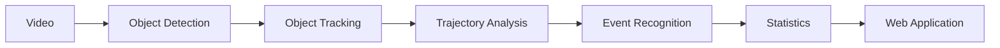

# Disc Dog Analytics

[Live Demo](https://petlo-tracking.pages.dev/) · [Development Log](docs/development-log.md)

> The online demo shows the interface prototype and sample data. Use the local full-stack setup below for real video analysis and completed reports.

**Project title:** Robust Detection and Event Recognition for Fast Small-Object Sports Analytics: A Disc Dog Case Study  
**Client:** petlo.my

---

## Overview

This project develops a computer vision-based video analytics system for pre-recorded disc dog training videos. The system estimates the number of throws, successful catches, and misses; calculates catch ratios; associates events with timestamps; and supports the review of historical training performance.

The repository includes video inspection utilities, enhanced object detection, dog and disc tracking, joint analysis, throw-event candidate generation, two-angle sample fusion, candidate session statistics, and a full-stack local web application (React frontend + FastAPI backend).

---

## Planned Pipeline



Detection, tracking, and event recognition are distinct stages:
- **Object Detection & Tracking:** Identifies the dog and disc across frames and recovers disc trajectories during motion blur or occlusion.
- **Joint Analysis & Event Recognition:** Evaluates the relative motion between dog and disc to detect candidate events (*in-air catch*, *ground pickup*, *miss*, *uncertain*).
- **Statistics & Dashboard:** Aggregates session metrics and visualizes event timelines and historical trends.

---

## Technology Stack

- **Computer Vision:** Python, OpenCV, PyTorch, Ultralytics YOLOv8
- **Backend:** FastAPI, Uvicorn, SQLite (local) / MySQL (team schema), SQLAlchemy
- **Frontend:** React 19, TypeScript, Vite, Recharts, React Router (supports both Demo mode and Live API mode)
- **Tooling:** FFmpeg / ffprobe (frame extraction & video preprocessing), PowerShell automation scripts

---

## Prerequisites

Before running the application locally, ensure you have:

1. **Python 3.10+**
2. **Node.js 18+** & npm
3. **FFmpeg & ffprobe**: Installed on your system `PATH` or placed inside `tools/ffmpeg/`
4. **YOLO Weights**: Place `yolo11n.pt` (or your configured YOLO weights) in the repository root

---

## Setup & Running Locally

### Option A: Full-Stack Web Application (Recommended)

This runs the complete system: the React frontend, the FastAPI backend, and background CV processing.

1. **Set up Python Virtual Environment & Dependencies:**
   ```powershell
   python -m venv .venv
   .\.venv\Scripts\Activate.ps1
   python -m pip install -r cv/requirements.txt -r backend/requirements-dev.txt
   ```

2. **Install Frontend Dependencies:**
   ```powershell
   npm ci
   ```

3. **Launch the Application:**
   ```powershell
   powershell -ExecutionPolicy Bypass -File scripts/start-local-demo.ps1 -OpenBrowser
   ```
   - **Web Dashboard:** `http://localhost:5173`
   - **API Documentation:** `http://127.0.0.1:8000/docs`
   - Background job progress and logs are written to `outputs/local-demo/`.

4. **Stop Services:**
   When finished, stop background processes cleanly:
   ```powershell
   powershell -ExecutionPolicy Bypass -File scripts/stop-local-demo.ps1
   ```

---

### Option B: Standalone Computer Vision CLI (Algorithms Only)

If you only wish to test the video tools and computer vision models directly from the command line:

1. **Activate the Virtual Environment:**
   ```powershell
   .\.venv\Scripts\Activate.ps1
   ```

2. **Place an authorized test video in `data/raw/`** (e.g. `data/raw/sample.mp4`).

3. **Inspect Video Metadata:**
   ```powershell
   python cv/video_info.py data/raw/sample.mp4
   ```

4. **Extract Sample Frames:**
   ```powershell
   python cv/extract_frames.py data/raw/sample.mp4 --output-dir data/frames/sample --every-n-frames 30
   ```

5. **Run Baseline Object Detection:**
   ```powershell
   python cv/detect_video.py data/raw/sample.mp4 --output outputs/sample_detected.mp4
   ```

6. **Interactive Video Tools Menu (Windows):**
   You can also launch the command helper directly:
   ```cmd
   run-video-tools.cmd
   ```

---

## Testing & Verification

Run the test suite across backend, frontend, and CV modules:

```powershell
# Python unit tests
.\.venv\Scripts\python.exe -m unittest discover -s backend/tests -v
.\.venv\Scripts\python.exe -m unittest discover -s tests -v

# Frontend tests and build check
npm run test:api
npm run build
```

---

## Roadmap

- [x] Project definition & initial architecture
- [x] Video inspection and deterministic frame extraction
- [x] Real-timestamp video packet and review tools
- [x] Pretrained detection baseline with small-disc enhancement
- [x] Single-dog tracking prototype and pixel trajectory export
- [x] Throw-event candidate prototype (in-air catch, ground pickup, miss)
- [x] Sample throw-event statistics & dual-angle fusion
- [x] Local backend API & background job adapter
- [x] Frontend demo mode and live API mode
- [x] Local SQLite persistence & MySQL schema compatibility
- [ ] General outdoor event-recognition evaluation across diverse datasets
- [ ] Calibrated physical measurements & mouth-level catch detection
- [ ] Public multi-user cloud deployment & authentication

---

## Further Documentation

- [Project Overview](docs/project-overview.md)
- [System Architecture](docs/architecture.md)
- [API Contract](docs/api-contract.md)
- [Backend Handoff & Architecture](docs/backend-handoff.md)
- [Computer Vision Module](cv/README.md)
- [Video Analysis Workflow](docs/video-analysis-workflow.md)
- [Dog Tracking Implementation](docs/dog-tracking-prototype.md)
- [Throw Events v3 Specification](docs/throw-events-v3.md)
- [User Requirements Specification](docs/user-requirements-specification.md)
- [Performance & Benchmarks](docs/performance.md)

---

## 简要中文说明 (Chinese Summary)

本项目（**Disc Dog Analytics**）是为 **petlo.my** 开发的飞盘犬训练视频计算机视觉分析系统。系统通过目标检测与追踪技术，分析预录训练视频中飞盘与犬只的运动轨迹，自动识别投掷、空中接盘、落地捡盘及未接盘等事件，统计成功率并生成训练报告。

### 本地快速启动

1. **环境准备：** 安装 Python 3.10+、Node.js 18+、FFmpeg，并在根目录放置 YOLO 权重文件（`yolo11n.pt`）。
2. **安装依赖：**
   ```powershell
   python -m venv .venv
   .\.venv\Scripts\Activate.ps1
   python -m pip install -r cv/requirements.txt -r backend/requirements-dev.txt
   npm ci
   ```
3. **一键启动前后端：**
   ```powershell
   powershell -ExecutionPolicy Bypass -File scripts/start-local-demo.ps1 -OpenBrowser
   ```
   - 前端页面：`http://localhost:5173`
   - 后端文档：`http://127.0.0.1:8000/docs`
4. **停止运行：**
   ```powershell
   powershell -ExecutionPolicy Bypass -File scripts/stop-local-demo.ps1
   ```
更多技术细节与接口规范请参阅 `docs/` 目录。
