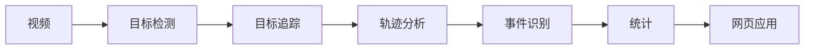

# Disc Dog Analytics

[中文](README.zh-CN.md) | [English](README.md)

[在线演示](https://petlo-tracking.pages.dev/) · [开发日志](docs/development-log.md)

> 在线演示目前展示界面原型和示例数据。真实视频分析及已完成报告请使用下方说明的本地版本。

**项目名称：** 面向高速小目标运动分析的稳健检测与事件识别：以飞盘犬为例

**客户：** petlo.my

## 项目概述

本项目旨在为预先录制的飞盘犬训练视频开发计算机视觉分析系统。计划实现投掷次数、成功接盘次数和未接盘次数的估计，计算接盘率，为事件关联时间戳，并支持查看历史训练表现。

项目已从可行性研究推进到基于现有样本的算法原型阶段。仓库包含视频检查、增强目标检测、狗与飞盘追踪、联合分析、投掷事件候选、双视角样本融合及训练候选统计。本地网页与 API 已完成集成；通用事件识别准确率、生产环境多用户访问和公网算法后端仍待验证或实现。

## 要解决的问题

人工查看训练录像较为耗时。自动分析可以辅助汇总训练过程，但这些视频存在以下计算机视觉难点：

- 飞盘在画面中占比小
- 高速运动与运动模糊
- 短暂消失和遮挡
- 背景复杂
- 拍摄距离不同
- 录制环境存在差异

这些难点尚未被全面解决。评估检测质量和事件识别效果，需要更具代表性的项目视频以及人工标注证据。

## 计划中的处理流程



检测、追踪和事件识别是不同阶段。检测到飞盘，或者飞盘暂时消失，本身都不能证明发生了投掷、接盘或未接盘事件。

## 计划中的核心功能

以下内容是产品目标；当前本地实现和限制见后文：

- 视频上传
- 狗的检测
- 飞盘检测与追踪
- 投掷、接盘和未接盘事件识别
- 接盘率计算
- 事件时间线
- 训练记录历史
- 历史表现分析

## 当前开发阶段

当前仓库提供：

- 初步项目需求
- 当前及未来架构的初步设计
- 视频检查工具
- 确定性抽帧
- 保留真实时间戳的视频资料包、画面变化候选、裁剪检查及结果复核工具
- 在四段样本上测试过的预训练目标检测与小飞盘检测增强
- 单狗轨迹 ID、有限时间内的漏检预测、像素轨迹和追踪回放
- 数据集准备计划
- 用于后续实验的发现记录模板

四段本地样本视频均已完成完整解码和资料包准备，包括 4K HEVC 视频。事件候选原型分析固定机位的正面和侧面样本；独立的训练统计报告汇总候选结果，计算时不使用人工标签。用户人工核对的侧面标签为三次空中接盘和一次落地捡盘；v3 融合顺序对应的双视角，产生相同的四个候选结果。这四次事件参与过规则开发，因此样本上的 4/4 一致不能视为独立准确率。侧面第二次事件因飞盘飞出画面，单视角结果仍为 uncertain；正面视角提供落地捡盘候选。

## 初步技术方向

- **计算机视觉：** Python、OpenCV、PyTorch，以及作为初始基线候选的 Ultralytics YOLO
- **本地后端：** FastAPI 与后台 CV 任务适配层
- **前端：** React、TypeScript 和 Vite，区分演示模式与 API 模式
- **数据库：** 本地集成测试使用 SQLite；为组员的 MySQL 数据库提供 SQLAlchemy 映射与增量 DDL

技术选择可能随评估结果调整。目前已实现 Vite/React 前端与本地 FastAPI 后端集成。本地测试使用 SQLite，并提供对接组员 MySQL 数据库的增量映射。生产环境身份认证与公网后端部署仍待完成。

## 本地网页演示（2026-10-22）

按照[本地全栈测试指南](docs/local-full-stack-testing.md)安装依赖后，在仓库根目录运行：

```powershell
powershell -ExecutionPolicy Bypass -File scripts/start-local-demo.ps1 -OpenBrowser
```

脚本启动或复用仅监听本机回环地址的服务，不上传代码，也不修改 CV 算法。上传后进入可重新打开的任务状态页，显示真实处理阶段和自提交以来的时间。已完成的记录支持按视角回放事件、候选统计、JSON/CSV 下载和历史查看。界面不虚构处理百分比或预计剩余时间。执行任务期间请保持后端运行。

使用[演示检查清单](docs/local-demo-checklist.md)排练完整原始样本、保留已保存报告，并练习处理连接错误。本地默认单文件上传上限为 1024 MiB，以容纳未经修改的侧面样本；这与公网托管限制无关。

## 快速开始

以下命令适用于 Windows PowerShell，均在仓库根目录运行。

1. 创建并激活虚拟环境：

   ```powershell
   python -m venv .venv
   .\.venv\Scripts\Activate.ps1
   ```

2. 安装当前计算机视觉依赖：

   ```powershell
   python -m pip install -r cv/requirements.txt
   ```

3. 将已获本地使用授权的测试视频放入 `data/raw/`。此目录中的视频文件已被 Git 忽略。

4. 检查视频元数据：

   ```powershell
   python cv/video_info.py data/raw/sample.mp4
   ```

5. 每隔三十帧抽取一张，或指定其他正整数间隔：

   ```powershell
   python cv/extract_frames.py data/raw/sample.mp4
   python cv/extract_frames.py data/raw/sample.mp4 --output-dir data/frames/sample --every-n-frames 30
   ```

6. 运行预训练检测基线：

   ```powershell
   python cv/detect_video.py data/raw/sample.mp4
   python cv/detect_video.py data/raw/sample.mp4 --output outputs/sample_detected.mp4
   ```

第一次运行检测程序时，可能通过 Ultralytics 包获取轻量模型权重。模型权重和生成的视频应保留在版本控制之外。

## 精确视频资料包与算法复核

资料包流程使用 FFmpeg 和 ffprobe，保留每一张真实源帧的时间戳。它生成低频浏览帧、四张概览图集、基于画面变化的候选窗口，以及可还原坐标的原始像素裁剪。还支持读取狗追踪器的 JSONL 输出，生成带标记的截图、连续帧 HTML 回放和可比较运行结果的诊断信息。

在仓库根目录运行，使用 `tools/ffmpeg/` 中的本地 FFmpeg/ffprobe，或通过 `--ffmpeg-dir` 指定位置：

```powershell
py -3 -m cv.video_tools prepare --source '<sample-video-directory>' --output outputs/video-analysis-pack
py -3 -m cv.video_tools inspect-window --pack outputs/video-analysis-pack --video-id Portrait_Handheld --start 0 --end 1 --frame-id 0 --tiles
```

已有资料包可在本地通过 `outputs/video-analysis-pack/index.html` 打开。模型首轮读取四张概览图集；每次精查最多读取八张独立图片。预处理在本地离线运行，不调用 GPT；图片读取与代码开发仍会消耗模型使用额度。

参见[视频分析流程](docs/video-analysis-workflow.md)和[详细命令说明](cv/video_tools/README.md)。`track_dog_video.py` 将保存的增强检测结果转换为经过校验的追踪结果格式。参见[狗追踪与测试命令](docs/dog-tracking-prototype.md)；已有基线 `detect_video.py` 仍作为独立入口保留。

## 开发路线

- [x] 项目定义
- [x] 初步需求
- [x] 初步架构
- [x] 视频检查工具
- [x] 抽帧工具
- [x] 真实时间戳资料包与复核工具
- [x] 四段本地样本的完整解码
- [x] 基线检测原型
- [ ] 数据集收集
- [ ] 面向飞盘领域的专门标注
- [ ] 基线评估
- [ ] 检测模型微调
- [x] 单狗追踪原型与像素轨迹导出
- [ ] 飞盘追踪与身份关联评估
- [ ] 经过标定的轨迹分析
- [x] 投掷事件候选原型
- [x] 样本投掷事件统计原型
- [ ] 通用事件识别评估
- [x] 本地后端 API 与 CV 任务集成
- [ ] 公网后端身份认证与托管
- [x] 前端演示页面及可选 API 页面
- [x] 本地 SQLite 持久化
- [ ] 真实 MySQL 连接验证
- [x] 本地视频到结果的流程集成
- [ ] 生产环境系统集成
- [ ] 测试
- [x] 静态前端部署
- [ ] 公网后端部署

## 更多文档

- [项目概述](docs/project-overview.md)
- [初步需求](docs/requirements.md)
- [导师与客户待确认问题](docs/supervisor-questions.md)
- [架构](docs/architecture.md)
- [数据集策略](docs/dataset-plan.md)
- [可行性发现模板](docs/initial-findings.md)
- [计算机视觉模块](cv/README.md)
- [视频分析流程](docs/video-analysis-workflow.md)
- [狗追踪实现与样本测试](docs/dog-tracking-prototype.md)
- [投掷事件 v3 样本评估](docs/throw-events-v3.md)
- [用户需求规格草稿](docs/user-requirements-specification.md)
- [投掷事件样本统计](docs/throw-events-v3.md#样本事件统计)

## 本地全栈集成（2026-10-20）

原有 CV 阶段通过仅监听本机回环地址的 FastAPI 服务接入，持久化保存视频、训练记录、任务和事件，并按源时间回放。设置 `VITE_USE_API=true` 启用真实接口页面；不设置或设为 false 则使用原演示页面。参见[本地全栈测试指南](docs/local-full-stack-testing.md)、[后端启动与限制](backend/README.md)和[API 约定](docs/api-contract.md)。不要公开私有环境配置、数据库、上传视频、模型权重或生成的分析资料。现有 Pages 网站只部署前端，不运行本地 Python 服务。
