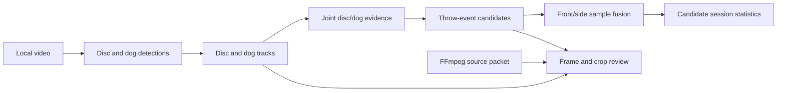
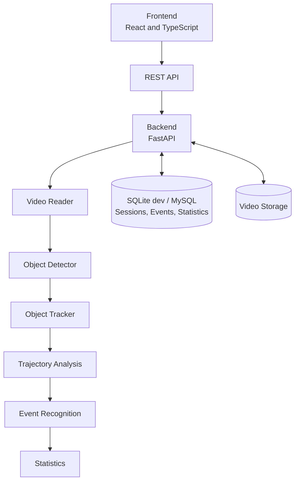

# System Architecture

## Architecture Principles

Detection, tracking, trajectory evidence, event candidates, and statistics are separate stages. A detection or a temporary disappearance alone does not establish a catch or miss. Each stage produces inspectable outputs and keeps uncertain events explicit.

## Current Local Prototype

The current command-line workflow has two paths: a source-reading/review path and a sample event-analysis path. The event path is tested on the fixed front and side sample videos only.

The FFmpeg packet stores real frame timestamps and supports browsing, crops, and result review. Algorithms still process continuous source frames. The event prototype analyzes the front and side tripod samples, pairs their four attempts by event order, and leaves the views' timestamps independent. The statistics report distinguishes in-air catch candidates, ground-pickup candidates, miss candidates, and uncertain outcomes. Human labels are used only for sample comparison, not to calculate candidate statistics.

## Component Status

| Component | Current status |
|---|---|
| Video reader and source packet | Implemented; four local samples completely decoded and indexed |
| Dog detector and tracker | Prototype implemented; provisional single-dog IDs and pixel trajectories |
| Disc detector and tracker | Small-disc detection and tracking prototypes; sample review tools available |
| Joint dog/disc evidence | Prototype implemented with source-time and observation provenance |
| Throw-event recognition | Sample-bound candidate rules; no mouth localization or general accuracy claim |
| Two-angle fusion | Implemented for the matching, ordered front/side sample recordings only |
| Session statistics | Candidate counts, in-air catch candidate rate, retrieval candidate rate, and uncertainty coverage |
| Accuracy evaluation | Four user-reviewed side labels provide a sample diagnostic, not independent evaluation |
| REST API and frontend integration | Implemented in local single-user mode; real uploads, jobs, persistence and playback |
| Database | SQLite development tested; additive MySQL mapping/migration supplied, live MySQL validation pending |
| Deployment | Static frontend on Pages; public backend/authentication pending |
| Physical distance and speed | Not implemented; camera calibration is required |

Candidate statistics currently use classified candidate events as their denominator; uncertain events are reported separately and excluded. Ground pickups count as non-air catches for the in-air catch candidate rate and as retrieved for the retrieval candidate rate. These rates describe model candidates, not verified outcomes.

## Future Application Architecture

This is a proposed system direction. The web interface, REST API and development database now have a local integration implementation (see backend/README.md); the public backend deployment is still pending. Multi-camera synchronization and reliable matching outside the supplied sample also remain future work.

## Implemented local integration

`React Live pages → FastAPI → SQLAlchemy + local SQLite / configured MySQL`. Uploads are stored outside source code. A single background executor invokes the original source packet, detector, trackers, joint/event scripts and candidate-statistics adapter in isolated job directories. Original verified CFR evidence previews stay with CV review; a separate H.264 preview preserves relative source timestamps for API playback. The public Pages app only serves the static frontend. Local development is loopback-only; authentication and a remote worker/storage service remain required for public integration.

### Local demo task and report flow

`Upload → persisted session/current_job_id → /sessions/:id/analysis → saved report`. Status pages restore server-side identity after navigation/reload and only observe the existing task. A reconnect action resumes GET polling, never repeats the analysis POST. The saved list refreshes while it contains active work. Persisted job submission/completion timestamps drive elapsed time; status-query success is not a worker heartbeat. Report JSON and per-view event CSV preserve candidate semantics, unknown rates and independent source clocks. Startup scripts bind services to loopback and retain private runtime artifacts under ignored directories.
